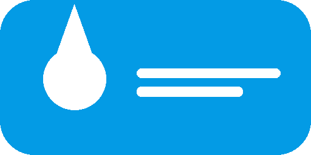
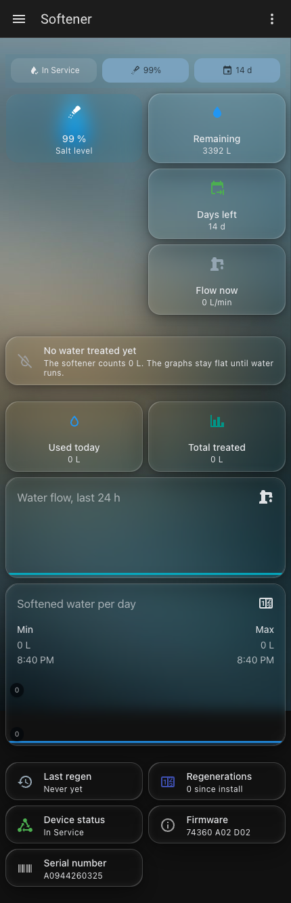
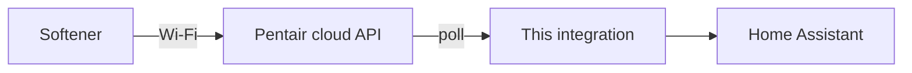

# ConnectMySoftener for Home Assistant



A Home Assistant integration for Pentair / Erie water softeners that use the
**ConnectMySoftener** app (Erie, Van Marcke and other Pentair brands).

Fork of [`lemick007/vanmarcke-softener`](https://github.com/lemick007/vanmarcke-softener).

Not affiliated with Pentair, Erie or Van Marcke. Use at your own risk.

## What it gives you

| Entity | Unit | Notes |
| --- | --- | --- |
| `sensor.<device>_status` | – | For example `In Service` |
| `sensor.<device>_salt_level` | % | |
| `sensor.<device>_remaining_water` | L | Water left before the next regeneration |
| `sensor.<device>_days_until_regeneration` | d | |
| `sensor.<device>_last_regeneration` | timestamp | |
| `sensor.<device>_regenerations` | – | Total count |
| `sensor.<device>_total_treated_water` | L | |
| `sensor.<device>_daily_consumption` | L | Resets at local midnight |
| `sensor.<device>_water_flow` | L/min | Polled every 30 seconds |
| `sensor.<device>_software_version` | – | Diagnostic |

The device page also shows the serial number and the software version.

## Screenshot



This is an old upstream screenshot. This fork uses English names.

## How it works

The integration logs in to the Pentair cloud API with the account of the
ConnectMySoftener app. It polls the API and never talks to the softener
directly.



The only public endpoint is `connectmysoftenerapi.pentair.eu`. Accounts from
every region use it.

## Install

1. Install [HACS](https://hacs.xyz/).
2. HACS → Integrations → three-dot menu → **Custom repositories**.
3. Add `https://github.com/YogevKr/connectmysoftener-ha` with category
   **Integration**.
4. Download it, then restart Home Assistant.

[](https://my.home-assistant.io/redirect/hacs_repository/?owner=YogevKr&repository=connectmysoftener-ha&category=Integrations)

## Set up

1. Install the ConnectMySoftener app and connect the softener to Wi-Fi.
2. Home Assistant → Settings → Devices & Services → **Add integration** →
   **ConnectMySoftener**.
3. Enter the email and the password of the app.

## Options

**Poll interval** sets how often the values refresh. The default is 300
seconds. The water flow keeps its own 30 second poll, because a slow poll
almost always misses the flow.

## Limits

- The values are cloud values, not live device values. The cloud is the only
  source.
- A flow reading is a snapshot. Short water use can stay unseen.
- The API is private and can change without notice.
- The payload of `last_regeneration` is empty on a new device. The parser
  reads ISO 8601 and a few common shapes, and logs a warning when it meets an
  unknown shape.

## Troubleshooting

| Problem | Fix |
| --- | --- |
| `invalid_auth` | Check the email and the password. Try the app first. |
| `cannot_connect` | Check the internet connection of Home Assistant. |
| `no_devices` | The account holds no softener. Pair it in the app. |
| Values freeze | Look at the log for `connectmysoftener`. |

Enable debug logging:

```yaml
logger:
  logs:
    custom_components.connectmysoftener: debug
```

## Test

```sh
uv run --with homeassistant --with pytest --with aiohttp pytest
uv run --with ruff ruff check .
```

## License

[CC BY-NC-SA 4.0](LICENSE). Copyright (c) 2025 lemick007, changes (c) 2026
YogevKr.

Non-commercial use is free. Name the source, and keep changed versions under
the same license. The upstream terms of
[`lemick007/vanmarcke-softener`](https://github.com/lemick007/vanmarcke-softener)
stay in force.
